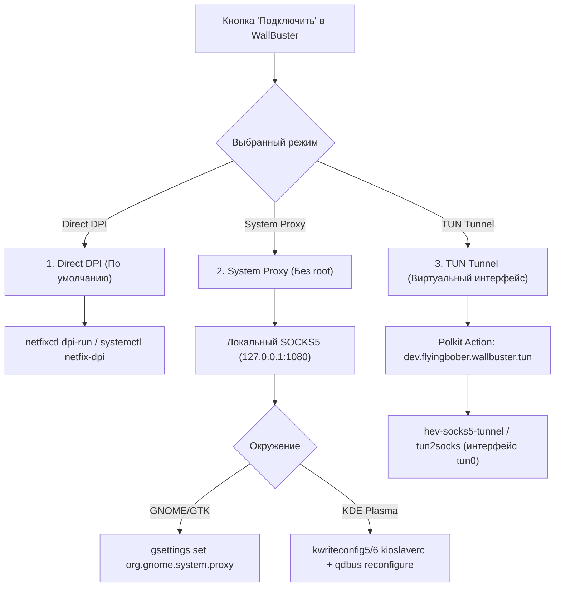

# WallBuster Linux Desktop GUI Design Specification

**Application Name:** WallBuster  
**Application ID:** `dev.flyingbober.wallbuster`  
**Binary Name:** `wallbuster`  
**License Notice / Header:** `WallBuster — (fork of NetFix Mobile by rupleide)`  
**Target Platform:** Linux Desktop (GNOME, KDE Plasma 5/6, XFCE, Wayland & X11)  
**Technology Stack:** Tauri v2 (Rust Backend + Vite / Vue 3 + Tailwind CSS + Lucide Icons)

---

## 1. Compliance & Licensing Requirements

1. **Brand Independence:** The application is named **WallBuster** and does not use the trademark "NetFix" in UI titles or desktop entry.
2. **Sub-header Attribution:** The application titlebar and about screen display:  
   `WallBuster — (fork of NetFix Mobile by rupleide)`
3. **First-Run Modal Disclaimer:** On initial launch before main interaction, a dialog appears:
   - Informs the user that WallBuster is an independent Linux client based on NetFix Mobile by rupleide.
   - Requires clicking "Я понимаю / Начать работу".
   - Persists `disclaimer_accepted: true` in `~/.config/wallbuster/gui_state.json`.

---

## 2. Architecture & Traffic Modes

WallBuster provides three complementary modes of traffic routing:



### 2.1 Mode 1: Direct DPI (Kernel NFQUEUE)
- Operates via the existing systemd headless service `netfix-dpi.service` (`nfqws`).
- No proxy configuration required on client apps; packets are desynced in kernel network stack.
- Status and strategy switching controlled via `netfixctl --json`.

### 2.2 Mode 2: System Proxy (Rootless)
- Spawns `ciadpi` (or internal SOCKS5 bridge) listening on `127.0.0.1:1080`.
- Automatically configures desktop environment proxy settings directly from Rust without root/sudo:
  - **GNOME:** `gsettings set org.gnome.system.proxy mode 'manual'` + SOCKS host/port.
  - **KDE Plasma 5 & 6:** `kwriteconfig5` or `kwriteconfig6` modifying `kioslaverc` (`ProxyType=1`, `socksProxy=socks://127.0.0.1:1080`), reloaded via `qdbus org.kde.kded5 /kded reconfigure`.
  - Reverts proxy cleanly to `none` on disconnect or application exit.

### 2.3 Mode 3: TUN Mode (Virtual Network Adapter)
- Creates virtual network adapter `tun0` routing system traffic into local bypass socks.
- Uses Polkit action `/usr/share/polkit-1/actions/dev.flyingbober.wallbuster.policy` with `<allow_active>yes</allow_active>` to start/stop the TUN interface without recurring password prompts.

---

## 3. UI/UX Layout (Clash Verge + Nekoray Aesthetic)

```
┌──────────────────┬──────────────────────────────────────────────────────────────┐
│  ⚡ WallBuster   │  WallBuster v1.0.0 — (fork of NetFix Mobile by rupleide)  ─ □ ✕│
├──────────────────┼──────────────────────────────────────────────────────────────┤
│ ⌂ Главная        │   [ СЕТЬ: DockStation Ethernet  |  PING: YouTube 28ms ]      │
│ ☷ Стратегии      │                                                              │
│ ✈ Telegram Proxy │                     ╭──────────────╮                         │
│ ▤ Логи           │                     │   ПОДКЛЮЧЕНО │ (Пульсирующее кольцо)   │
│ ⚙ Настройки      │                     ╰──────────────╯                         │
│                  │                                                              │
│                  │  ┌─────────────────────────┐  ┌───────────────────────────┐  │
│                  │  │ ⚡ Обход DPI (ByeDPI)   │  │ ✈ Telegram Proxy (WS)     │  │
│                  │  │ Статус: Активен         │  │ Статус: 127.0.0.1:1443    │  │
│                  │  │ Стратегия: fake,split   │  │ Активных сессий: 11       │  │
│                  │  │ Задержка: 28 ms         │  │ Cloudflare: Подключен     │  │
│                  │  └─────────────────────────┘  └───────────────────────────┘  │
│                  │                                                              │
│                  │  Режим: (•) Direct DPI    ( ) System Proxy    ( ) TUN Tunnel │
└──────────────────┴──────────────────────────────────────────────────────────────┘
```

1. **Fixed Left Sidebar (200px width):**
   - Navigation links: Dashboard, Strategies, Telegram Proxy, Logs, Settings.
   - Version footer and backend daemon connectivity status indicator.
2. **Dashboard (Главная):**
   - Hero button: central one-click toggle with smooth gradient and ripple pulse animation when connected.
   - Status Cards:
     - DPI bypass card: status, active strategy name, ping badges (YouTube, Discord).
     - Telegram Proxy card: status, port, session counter, Cloudflare WebSocket status.
   - Mode switcher: Direct DPI / System Proxy / TUN interface radio cards.
3. **Strategies (Стратегии):**
   - Grid of strategy cards with capability tags (`YouTube`, `Discord`, `QUIC HTTP/3`, `TLS`).
   - "Автоподбор стратегии" button opening a scan progress modal testing hosts.
4. **Telegram Proxy:**
   - Deep link button `tg://proxy?server=127.0.0.1&port=1443&secret=...`.
   - Live rendered SVG QR code for mobile Telegram scanning.
   - Cloudflare pinning selector.
5. **Live Logs (Nekoray Style):**
   - Streaming monospace console with colorized log severity badges.
   - Filter buttons: All, INFO, WARN, ERROR.
   - Pause / Resume auto-scroll and "Clear" buttons.
6. **Settings:**
   - DNS preset selector (System / Cloudflare / Google / Quad9 / AdGuard) with DoT toggle.
   - Autostart toggle creating `~/.config/autostart/dev.flyingbober.wallbuster.desktop`.
   - Polkit helper installer button.

---

## 4. System Tray & Lifecycle

- Native Linux System Tray icon with dynamic states:
  - `connected` (accent green glow icon).
  - `disconnected` (muted gray icon).
- Context menu:
  - "Открыть WallBuster"
  - "Включить / Отключить"
  - "Сменить стратегию"
  - "Выход"
- Window close button minimizes to tray instead of terminating background traffic.
